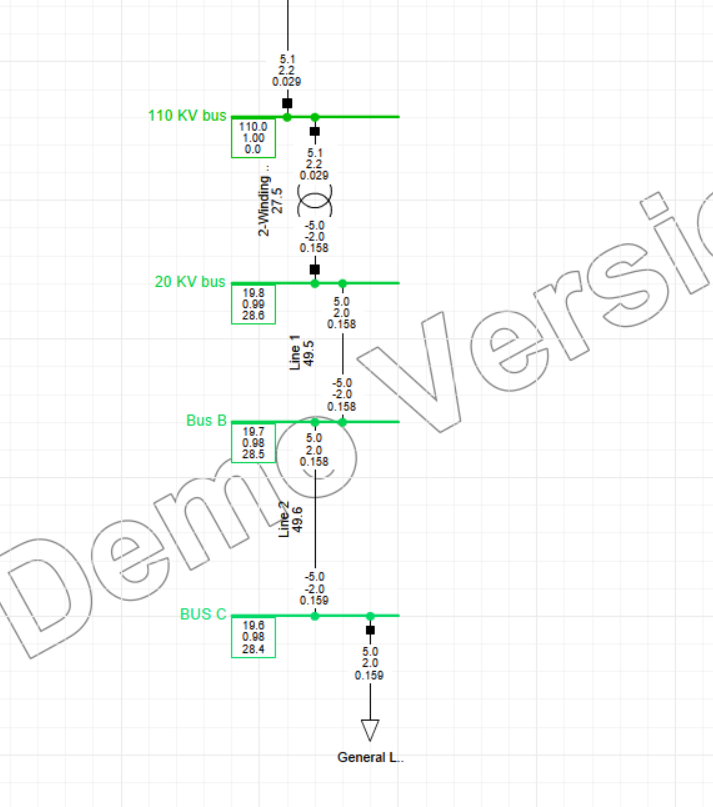
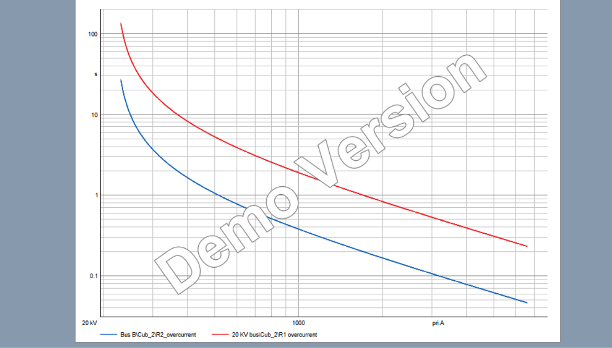
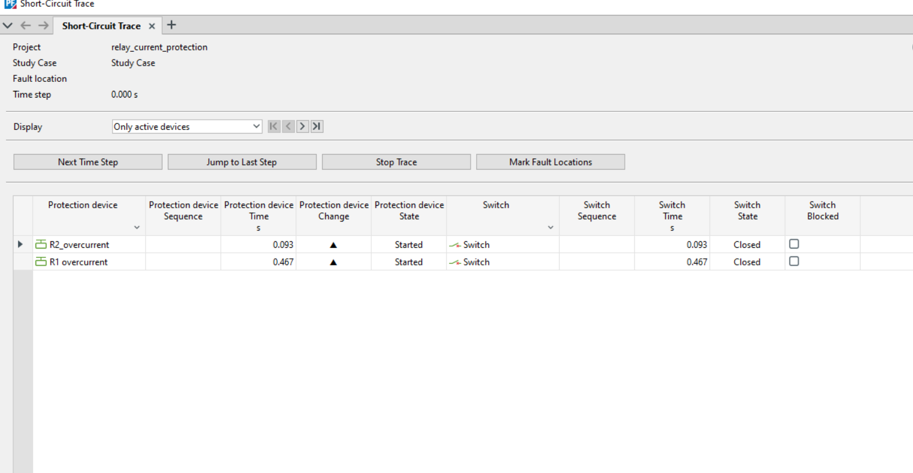
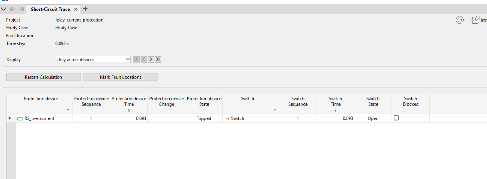
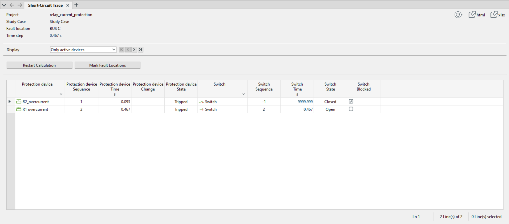
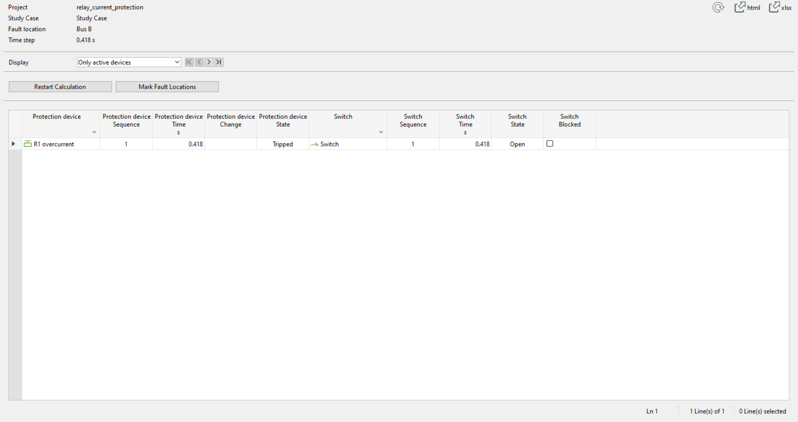
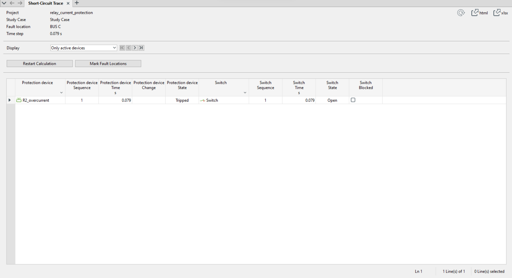

# Overcurrent Protection Coordination of a 20-kV Distribution Feeder

**DIgSILENT PowerFactory | IEC 60909 fault analysis | IEC 50/51 time-overcurrent relays**

A two-zone radial feeder study evaluating **fault-current sensitivity, inverse-time relay grading, selective fault clearing, and upstream backup protection**. The model uses a 110/20-kV grid supply, two 20-kV feeder sections, and a 5-MW/2-MVAr load. All main figures are screenshots of the actual PowerFactory results, not recreated illustrations.

> **Scope:** Educational network with published reference parameters and clearly stated assumptions—not a commissioned utility protection design.

## Network and operating point

`110-kV source → 110/20-kV transformer → 20-kV bus → [CB1, CT1, R1] → Line 1 → Bus B → [CB2, CT2, R2] → Line 2 → Bus C → 5 MW + 2 MVAr`



In the final normal-operation screenshot, the 110-kV bus is approximately 110.0 kV, the transformer secondary bus 19.8 kV, Bus B 19.7 kV and Bus C 19.6 kV. The load draws approximately 158–159 A, and both feeder sections are loaded near 50% of their modelled continuous-current ratings. Values are displayed with the rounding of the PowerFactory diagram.

### Model parameters and provenance

| Item | Modelled / study value | Basis and status |
|---|---|---|
| Transformer | 110/20 kV, 20 MVA, YNd11 | Selected network design; vector group and neutral/grounding strategy must be justified for earth-fault work |
| Transformer positive-sequence short-circuit voltage | **10%** | Published 20-MVA, 110-kV class typical transformer reference from Arcteq; used as an adapted study parameter, not a unit-specific certified datasheet [1] |
| Transformer load (copper) losses | **87 kW** | Same Arcteq reference [1]; intended updated project value, not independently re-read from final `.pfd` |
| Transformer no-load losses / no-load current | **13.5 kW / 0.20%** | Arcteq reference [1]; recommended reference values, but final entry into the model is not verified by the available screenshots |
| External-grid short-circuit strength | **1,000 MVA max / 500 MVA min** at 110 kV | Assumed scenarios. The *maximum* 1,000-MVA order of magnitude also appears in a BDEW worked example for a different network [2]; **500 MVA is a study assumption, not a BDEW requirement** |
| External-grid R/X | **0.1** | Assumed for both short-circuit cases; check model settings before reuse |
| Line 1 | 20-kV, 1-km radial cable | Project model, PowerFactory IEC library; cable type and length should be checked against the final `.pfd` |
| Line 2 | 20-kV, 1-km radial cable | 1 km in the Line 2 property screenshot; PowerFactory IEC library |
| Cable type / model current rating | `IEC/20kV/Al/VPE/NA2XS(F)2Y 1×120 RM 12/20kV` (library label abbreviated); **0.32 kA** shown | PowerFactory library and installation assumptions (ground, derating factor 1); manufacturer ampacity and installation derating not independently verified |
| Load | **5 MW + 2 MVAr** | Assumed constant load for study scenarios |
| Protection CTs | **200/1 A** each | User-selected study rating; protection class, accuracy limit factor, burden, and fault saturation **not validated** |
| Frequency | **50 Hz** | Study setting |

**Notes on transformer data.** Source [1] reports typical characteristics for a 20-MVA, 110-kV class power transformer. It does **not** uniquely establish the design, earthing, nameplate, losses or impedance of the simulated utility transformer. The previous 3% / 0-kW inputs were preliminary and are not used as a defensible final reference. For single-phase faults, the zero-sequence transformer data and the 20-kV system earthing configuration must be established independently.

**Notes on the cable.** This repository treats the selected PowerFactory cable library record as *model input*, not as proof of compliance with a particular supplier datasheet, route installation, or short-circuit thermal duty.

## 1. IEC 60909 short-circuit analysis

Balanced, bolted three-phase faults with zero specified fault impedance were studied at Bus B and Bus C under maximum and minimum fault-current conditions.

| Fault location | Maximum $I_k^{\prime\prime}$ (kA) | Minimum $I_k^{\prime\prime}$ (kA) | Maximum $S_k^{\prime\prime}$ (MVA) | Minimum $S_k^{\prime\prime}$ (MVA) |
|---|---:|---:|---:|---:|
| **Bus B** | **4.810** | **3.757** | 166.6 | 130.1 |
| **Bus C** | **4.393** | **3.381** | 152.2 | 117.1 |

The remote Bus C fault has a lower current because the fault path includes the additional Line 2 impedance. The minimum-case remote-end three-phase fault (**3.381 kA**) is well above normal feeder load current (~0.159 kA), providing adequate *ideal model* separation for the selected phase-overcurrent pickup. This does not establish performance for high-resistance faults, phase-to-earth faults, or a saturated CT. The source screenshots are in `evidence/short-circuit/` and the values are in `results/short_circuit_three_phase.csv`.

## 2. Protection setup

Two **Generic F50_F51 Phase Overcurrent** models were connected to separate 200/1-A CTs. Only the inverse-time `I>` stages were enabled in the initial coordination study; the higher stages `I>>`, `I>>>`, and `I>>>>` were placed out of service to avoid unintended high-set operation.

| Setting | R2 — downstream primary | R1 — upstream backup |
|---|---:|---:|
| Location | Bus B / Line 2 | 20-kV bus / Line 1 |
| CT ratio | 200/1 A | 200/1 A |
| IEC characteristic | Class B (Very Inverse) | Class B (Very Inverse) |
| Pickup | 1.10 pu = **220 A primary** | 1.10 pu = **220 A primary** |
| Time dial / TMS | **0.10** | **0.50** |
| Higher-set stages | Disabled for study | Disabled for study |

The pickup exceeds the single recorded normal operating current, but it is **not a finalized utility setting**: future load growth, emergency loading, CT performance, breaker duties and the coordination time margin require verification.



The curves show the intended **time grading**: at a common feeder-fault current, R2's inverse-time curve operates below R1's. Curve separation alone does not prove breaker operation; the event traces below test switching response.

## 3. Fault-clearing scenarios

### Case A — Bus C fault, downstream selective clearing (minimum short-circuit case)

Both overcurrent elements start. R2 has the earlier calculated operation time and opens CB2; R1 does not complete its trip.

| Device | Calculated operating time | Trace outcome |
|---|---:|---|
| **R2** | **0.093 s** | Tripped; CB2 open |
| R1 | 0.467 s (initially scheduled) | No trip shown after CB2 clears fault |





### Case B — CB2 blocked, R1 time-delayed upstream backup (minimum case)

The `Switch Blocked` option is applied **only to CB2** while the fault remains at Bus C. R2 operates at 0.093 s but cannot open CB2; the fault persists, and R1 subsequently trips and opens CB1 at 0.467 s.

| Device | Time | Trace outcome |
|---|---:|---|
| R2 / CB2 | **0.093 s** | R2 tripped; CB2 stayed **closed and blocked** |
| **R1 / CB1** | **0.467 s** | R1 tripped; CB1 **opened** |



This is **time-delayed backup using R1's existing overcurrent element**, **not** a separately modelled ANSI 50BF breaker-failure logic scheme. Opening CB1 de-energizes a larger portion of the downstream network.

### Case C — Bus B fault, R1 primary operation (minimum case)

Bus B is downstream of R1 and upstream of R2. The trace records **R1 tripped at 0.418 s**, with CB1 opened; R2 did not appear as an active tripping device.



### Case D — Bus C fault, downstream selective clearing (maximum case)

The same relay settings were retained while the referenced short-circuit calculation was changed to maximum current.

| Metric | Minimum case | Maximum case |
|---|---:|---:|
| Bus C $I_k^{\prime\prime}$ (kA) | 3.381 | 4.393 |
| R2 operating time (s) | **0.093** | **0.079** |
| R1 *initially scheduled* operating time (s) | 0.467 | 0.396 |
| Difference between initially scheduled times (s) | 0.374 | 0.317 |
| Trace result | R2 opens CB2 | R2 opens CB2 |



Both relays are faster at higher fault currents, as expected for the selected inverse characteristic. The differences in scheduled trip times are **not** fully validated grading margins because circuit-breaker opening time, relay tolerances and CT error were not modelled and checked as a complete protection-design package.

## Interpretation and limitations

The simulations support these **specific** findings:

- At the **Bus C** fault, R2 is faster and clears the fault selectively in both tested maximum/minimum grid conditions.
- With **CB2 blocked**, R1 clears the persistent Bus C fault as time-delayed upstream backup.
- At the **Bus B** fault, R1 acts as primary upstream protection.
- The short-circuit trace reports relay and switch operations at the *same timestamps*. This is **not evidence that real breakers have zero operating time**.

Before this study could inform actual engineering settings, it would require documented maximum/contingency loading, manufacturer-verified 110/20-kV transformer parameters, validated earthing and zero-sequence values, CT accuracy-limit/burden/saturation checks, breaker breaking and making duty, real operating delays and reclosing requirements, relay tolerances, coordination over the full fault-current range, and suitable checks for unbalanced/earth faults. No full automatic coordination audit or field validation is claimed.

## Repository contents

```text
figures/                      Selected original PowerFactory screenshots used in this README
evidence/network-and-equipment/  Input-model and operational screenshots
evidence/relay-configuration/    CT, stage and relay settings screenshots
evidence/short-circuit/         IEC 60909 calculation screenshots
evidence/traces/                Additional short-circuit and backup trace screenshots
results/                        Tabulated values transcribed from screenshots (CSV)
model/                          Notes on adding the native PowerFactory `.pfd`
```

The screenshots are original PowerFactory demo outputs and therefore contain their visible demo watermark. Numeric tables are transcribed from the displayed outputs and have not been independently checked against the native model file.

## References

1. **Arcteq**, *Transformer Wizard — Instruction Booklet*, v1.1, May 2023. Table of typical 110-kV oil-filled transformer characteristics, including the 20-MVA row (10% impedance, 87-kW load loss, 13.5-kW no-load loss, 0.20% no-load current). [Official PDF](https://www.arcteq.com/wp-content/uploads/2023/05/Transformer-Wizard-%E2%80%93-Instruction-booklet-v1.1-IM00081.pdf). **Reference example, not this transformer's manufacturer certificate.**
2. **BDEW**, *Technical Guideline: Generating Plants Connected to the Medium-Voltage Network*, June 2008, worked network example with 1,000-MVA upstream short-circuit power, a **different** 16-MVA/12% transformer and 92-kW transformer losses. [Reference copy](https://stadtwerke-service.de/wp-content/uploads/sites/6/2023/10/20080601_BDEW-Mittelspannungsrichtlinie.pdf). Used only to contextualize the **assumed** 1,000-MVA maximum-grid scenario, not as proof of the 500-MVA minimum.
3. **DIgSILENT**, *PowerFactory Knowledge Base: Why does the Short-Circuit Trace calculation use the Complete Method?* [Official explanation](https://www.digsilent.de/en/faq-reader-powerfactory/why-does-the-short-circuit-trace-calculation-use-the-complete-method.html). Methodology background on protection-device sequence and fault-clearing calculations.
4. **DIgSILENT**, *Results Reporting*. [Official white-paper overview](https://www.digsilent.de/en/paper-reader-pf-en/results-reporting.html). Methodology background for time-overcurrent and protection reporting.

**Reproducibility note:** This project was developed using the demonstration version of DIgSILENT PowerFactory, which does not permit exporting the simulation model in the current licence configuration. Therefore, the native PowerFactory project file (.pfd) is not included in this repository. Instead, selected simulation screenshots, technical parameters, relay settings, and numerical results are provided to document the modelling approach and findings.
